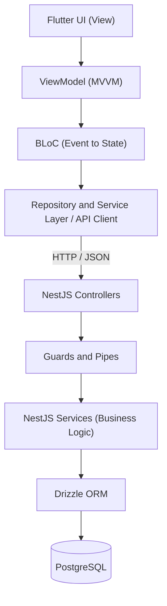

# Digital Banking Application


A mobile-first digital banking and wallet application built with Flutter, Dart, NestJS, TypeScript and PostgreSQL.

> **Status:** In active development. Features are marked as implemented only when the corresponding code exists.

## Table of Contents

- [Overview](#overview)
- [Features](#features)
- [Technology Stack](#technology-stack)
- [System Architecture](#system-architecture)
- [Architectural Decisions](#architectural-decisions)
- [Security and Authentication](#security-and-authentication)
- [Financial Transaction Integrity](#financial-transaction-integrity)
- [Database Design](#database-design)
- [API Design](#api-design)
- [Testing](#testing)
- [Getting Started](#getting-started)
- [Current Status and Future Work](#current-status-and-future-work)
- [License](#license)
- [Disclaimer](#disclaimer)

## Overview

This project explores secure authentication, modular backend architecture, relational data modeling and reliable financial transaction processing.

Flutter powers the mobile client, NestJS powers the backend, and PostgreSQL is the persistent data store. The architecture emphasizes separation of concerns, explicit business rules and data integrity.

The goal is not only to ship features but also to apply the engineering principles needed to build maintainable software that handles sensitive user information and financial operations.

[Back to top](#digital-banking-application)

## Features

| # | Feature | Description | Status |
|---|---------|-------------|--------|
| 1 | Authentication | Mobile-number sign-up and login with Argon2-hashed passwords and JWT sessions | Client built, API planned |
| 2 | Home dashboard | Personalized overview with wallet balance, transaction history and quick actions | In progress |
| 3 | Card management | Manage payment cards linked to the account | Planned |
| 4 | Customer care | In-app access to customer support | Planned |
| 5 | Notifications | Account and transaction alerts | Planned |
| 6 | Wallet balance management | Add money to the wallet and track the balance | Planned |
| 7 | Bank transfers | Send money with atomic, idempotent processing | Planned |
| 8 | Airtime purchases | Buy airtime directly from the wallet | Planned |
| 9 | Loan applications | Apply for and track loans | Planned |
| 10 | Transaction history | Browse past transactions with their statuses | Planned |
| 11 | Monthly financial insights | Monthly summaries of spending and activity | Planned |
| 12 | Account settings | Manage profile and security preferences | Planned |

The status column reflects what the code supports today and is updated as features are completed.

[Back to top](#digital-banking-application)

## Technology Stack

| Layer | Technology |
|-------|------------|
| Mobile client | Flutter, Dart |
| State management | BLoC |
| Mobile architecture | MVVM, modular structure, repository and service layers |
| Navigation | go_router |
| HTTP client | Dio |
| Backend | NestJS, TypeScript |
| HTTP platform | Fastify |
| Database | PostgreSQL |
| ORM | Drizzle ORM |
| Authentication | Passport strategies, JWT |
| Password hashing | Argon2 |
| Version control | Git |

[Back to top](#digital-banking-application)

## System Architecture

The diagram below shows the intended architecture.



### Architectural Responsibilities

| Layer | Responsibility |
|-------|----------------|
| Presentation (View) | Renders application state and collects user input |
| Presentation logic (ViewModel) | Exposes presentation-ready state and coordinates interactions between views and application services |
| State management (BLoC) | Coordinates user events, asynchronous operations and UI state transitions |
| Data access (Repository and services) | Calls the backend through Dio and hides API details from the rest of the app |
| Backend (NestJS) | Handles request validation, authentication, authorization and business logic |
| Persistence (Drizzle and PostgreSQL) | Drizzle provides typed database access; PostgreSQL enforces relational constraints and transactional guarantees |

[Back to top](#digital-banking-application)

## Architectural Decisions

### 1. MVVM and Separation of Concerns

The mobile app follows the Model-View-ViewModel pattern.

- **Model:** application data and domain concepts.
- **View:** displays state and forwards user interactions.
- **ViewModel:** coordinates presentation logic and exposes state for the view to render.

MVVM keeps presentation code from becoming tightly coupled to application logic, which improves testability and maintainability and lets the UI evolve independently of data-access and business concerns. MVVM defines the architectural responsibilities, while BLoC structures the event-driven state transitions inside them.

### 2. BLoC for Predictable State Management

BLoC is chosen over more permissive state-management approaches because it enforces explicit event-to-state transitions and a clear separation between presentation and application logic.

Instead of letting UI components mutate state arbitrarily, state changes are organized around events and emitted states. This makes asynchronous workflows such as authentication and wallet retrieval easier to reason about and test, and it supports consistent handling of loading, success, empty and failure states.

The advantage is architectural discipline and testability, not a claim that BLoC is universally better or faster than alternatives.

### 3. NestJS and Modular Backend Design

NestJS provides a modular architecture with dependency injection and clearly defined component responsibilities. Controllers handle HTTP interactions, services encapsulate business logic, and dedicated data-access components manage persistence. This keeps coupling low as functionality grows across authentication, users, wallets and transfers.

Fastify is the HTTP platform, keeping request handling separate from the core business logic.

### 4. Drizzle ORM and PostgreSQL

Drizzle ORM is chosen for its TypeScript-first schema definitions, explicit query construction and close alignment with SQL.

Compared with Prisma's more abstract query API and TypeORM's entity-oriented approach, Drizzle is a thin layer over SQL. That makes query behavior easier to inspect and gives more control over database operations, which suits latency-sensitive endpoints and complex relational queries.

Actual performance still depends on query design, indexes, connection management, data volume and workload. PostgreSQL remains responsible for constraints and transaction guarantees, and using an ORM does not remove the need to understand SQL, isolation levels, locking and concurrency.

[Back to top](#digital-banking-application)

## Security and Authentication

The application is designed around server-enforced security boundaries.

- **Authentication:** mobile-number-based credential verification with Argon2 password hashing.
- **Authorization:** protected endpoints verify that the authenticated user may access the requested resource.
- **Token management:** JWT-based authentication, with explicit handling of expiration, refresh and revocation.
- **Input validation:** the server validates all input and enforces business rules; client-side validation is for usability, not security.
- **Sensitive data:** password hashes, tokens and secrets must never appear in API responses, logs or version control.
- **Account protection (planned):** session invalidation and risk-based checks for suspicious activity.

A valid token establishes an authenticated identity. It does not authorize access to every resource, so ownership and permissions are checked independently.

[Back to top](#digital-banking-application)

## Financial Transaction Integrity

Financial operations need stronger guarantees than ordinary CRUD workflows. The transfer implementation is designed around these invariants:

| Invariant | Goal | Planned approach |
|-----------|------|------------------|
| Atomicity | Related debit and credit operations succeed or fail together | A single PostgreSQL transaction per transfer |
| Concurrency control | Simultaneous transfers cannot bypass balance checks | Row-level locking or conditional updates |
| Insufficient-funds protection | Balance validation stays correct under concurrent requests | Balance checks enforced in the database, backed by constraints |
| Idempotency | A retried request does not execute the same transfer twice | Client-supplied idempotency keys enforced by a unique constraint |
| Traceability | Every operation can be traced | Persistent transaction records with explicit statuses |
| Precision | No floating-point rounding errors | Integer minor units or exact-decimal values, never binary floating point |

[Back to top](#digital-banking-application)

## Database Design

PostgreSQL stores the application's core entities.

| Entity | Contents |
|--------|----------|
| Users | Identity information, unique mobile number, optional email, password hash, verification status, timestamps |
| Wallets | Owner, currency, monetary balance |
| Transactions | Transfer amount, associated wallets, operation status, timestamps |

Drizzle ORM provides typed schema definitions and queries, while database constraints enforce critical integrity rules at the persistence layer on top of application validation. The final schema will define the exact relationships and constraints required by the implemented workflows.

[Back to top](#digital-banking-application)

## API Design

The NestJS backend exposes a REST API consumed by the Flutter client. It is organized into modules with distinct responsibilities, with controllers handling requests and services implementing business operations.

| Module | Responsibility |
|--------|----------------|
| Auth | Registration, login, token issuance and refresh |
| Users | User profile and account data |
| Wallets | Wallet balances and wallet-related data |
| Transfers | Money transfers and transaction records |

All sensitive operations are validated and authorized on the backend. Endpoints never rely on client-supplied balances, identities or security decisions.

[Back to top](#digital-banking-application)

## Testing

Testing focuses on application correctness and security boundaries.

| Type | Scope |
|------|-------|
| Unit tests | Services, business rules and state transitions |
| Integration tests | Database interactions, constraints and transaction behavior |
| API tests | Validation, authentication, authorization and error handling |
| Financial workflow tests | Insufficient-funds protection, atomicity, concurrent operations and idempotency |

Tests cover failure scenarios as well as successful requests. Financial invariants are verified against real database behavior rather than inferred from application code alone.

[Back to top](#digital-banking-application)

## Getting Started

### Prerequisites

- Flutter SDK
- Node.js and npm
- PostgreSQL

### Run the mobile app

```bash
flutter pub get
flutter run
```

### Run the backend

The backend setup below is a template and will be finalized once the API is implemented.

```bash
npm install
cp .env.example .env   # set DATABASE_URL, JWT secrets and other values
npx drizzle-kit migrate
npm run start:dev
```

Never commit `.env` files or secrets to version control.

[Back to top](#digital-banking-application)

## Current Status and Future Work

- [x] Authentication (Flutter client)
- [ ] Home dashboard (in progress)
- [ ] NestJS backend and API integration
- [ ] Wallet and transfer workflows
- [ ] Remaining core features (cards, notifications, airtime, loans, insights, settings)
- [ ] Stronger session management
- [ ] Expanded automated test coverage
- [ ] Monitoring and suspicious-activity detection

[Back to top](#digital-banking-application)

## License

This project is licensed under the MIT License. See [license.md](license.md) for details.

[Back to top](#digital-banking-application)

## Disclaimer

> This project is built with production-grade engineering principles in mind, but it is **not** a live financial service. It must not be used to store real funds or process real financial transactions.

[Back to top](#digital-banking-application)
